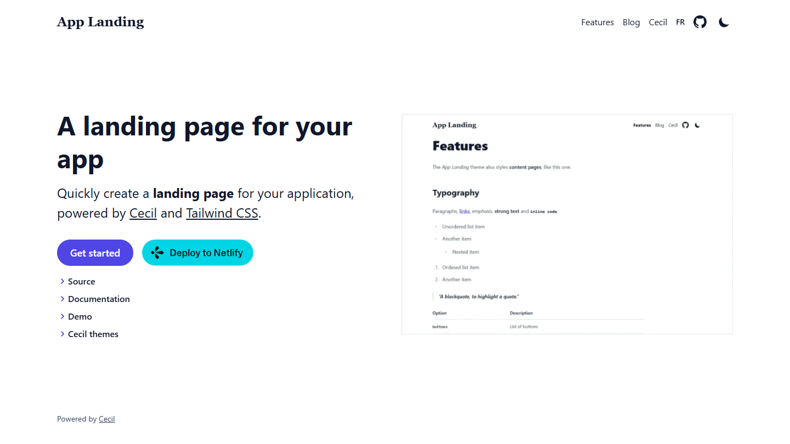

# App Landing theme

_App Landing_ is a [Cecil](https://cecil.app) theme designed to help you quickly create a landing page for your application, powered by [Tailwind CSS](https://tailwindcss.com).



**[Demo](https://cecilapp.github.io/theme-applanding/)**

## Features

- Landing page: baseline, introduction, buttons (image or text), links (source, documentation, demo and custom links) and screenshot
- Screenshot with dark mode and mobile variants
- Styled content pages: typography, code highlighting, [Markdown notes](https://cecil.app/documentation/content/markdown/#notes) (callouts, tabs, steps, accordion, cards)
- Configurable accent color (with a dark mode variant)
- Light and dark modes, with an optional toggle button ([darkmodetoggle](https://github.com/Cecilapp/theme-darkmodetoggle))
- Open Graph image generated for each page ([ogimage](https://github.com/Cecilapp/theme-ogimage))
- Accessible: skip link, `aria-current` menu, animations disabled when reduced motion is preferred
- Translated in English and French

## Requirements

- Cecil 9.29+
- The PHP GD extension with FreeType support, to generate the Open Graph images (otherwise a warning is logged and no image is generated)

## Installation

Allow the theme installer plugin in the `composer.json` file of your Cecil project (required since Composer 2.2):

```json
{
  "config": {
    "allow-plugins": {
      "cecil/theme-installer": true
    }
  }
}
```

Then require the theme:

```bash
composer require cecil/theme-applanding
```

The [ogimage](https://github.com/Cecilapp/theme-ogimage) component theme is installed with it.

> Or [download the latest archive](https://github.com/Cecilapp/theme-applanding/releases/latest/) and uncompress its content in `themes/applanding`, and do the same for [ogimage](https://github.com/Cecilapp/theme-ogimage/releases/latest/) in `themes/ogimage`.

## Usage

Add `applanding` in the `theme` section of your configuration file (`cecil.yml`):

```yaml
theme:
  - applanding
```

The content of the home page (`pages/index.md`) is displayed under the baseline (`baseline` option of the site).

### Configuration

Theme options, with their default values:

```yaml
applanding:
  buttons: []        # list of buttons: `{name: <name>, url: <url>, image: <optional image path or URL>}` (text button without image)
  source: ''         # URL of the source code: "Source" link and GitHub icon in the header
  documentation: ''  # URL of the documentation: "Documentation" link
  demo: ''           # URL of the demo: "Demo" link, and link of the screenshot
  links: []          # custom links, displayed after the previous ones: `{name: <name>, url: <url>}`
  screenshot: ''     # image displayed next to the baseline (path in `assets/` or URL)
  screenshot_alt: '' # alternative text of the screenshot ("Screenshot" by default)
  accent: ''         # accent color (CSS color, e.g. `#4f46e5`): text buttons, links and arrows; slate by default
  accent_contrast: '' # color of the text on the accent color (`#fff` by default)
  accent_dark: ''    # accent color in dark mode, preferably lighter (`accent` by default)
  accent_dark_contrast: '' # color of the text on the dark mode accent color (`#0f172a` by default)
```

**Example:**

```yaml
title: The Butler
baseline: A ready to use static blog
theme:
  - applanding
applanding:
  buttons:
    - name: Deploy to Netlify
      url: https://cecil.app/hosting/netlify/deploy
      image: https://www.netlify.com/img/deploy/button.svg
  source: https://github.com/Cecilapp/the-butler
  documentation: https://github.com/Cecilapp/the-butler#readme
  demo: https://the-butler-demo.cecil.app
  screenshot: cecil-preview.png
  screenshot_alt: Home page of The Butler
```

The entries of the `main` menu are displayed in the header.

### Screenshot

To display a distinct image on mobile, add an image suffixed with `.mobile` alongside the original one (e.g.: `preview.mobile.png`). The suffix and the media query can be changed with the [`layouts.images.mobile_suffix` and `layouts.images.mobile_media_query`](https://cecil.app/documentation/configuration/layouts/) options.

To display a dark mode variant, add an image suffixed with `.dark` alongside the original one (e.g.: `preview.dark.png`). The suffix can be changed with the [`layouts.images.dark_suffix`](https://cecil.app/documentation/configuration/layouts/) option.

### Dark mode toggle

By default, the color scheme follows the system preference. To add a toggle button in the header, install the [darkmodetoggle](https://github.com/Cecilapp/theme-darkmodetoggle) component theme and enable it before `applanding`:

```bash
composer require cecil/theme-darkmodetoggle
```

```yaml
theme:
  - darkmodetoggle
  - applanding
```

### Open Graph image

An Open Graph image is generated for each page by the [ogimage](https://github.com/Cecilapp/theme-ogimage) component theme, unless the page has an `image` (or `ogimage: false`) in its front matter. See its documentation to change the background, the colors or the fonts (`ogimage` options).

### Customization

The base layout (`_default/page.html.twig`) defines blocks you can override in your own layouts: `head_css`, `head`, `header`, `links`, `main`, `content`, `footer` and `scripts`.

```twig
{# layouts/index.html.twig #}



  <p>© My company</p>

```

### Internationalization

The theme is translated in English and French. To add a language, create a `translations/messages.<locale>.yaml` file in your site, from [`translations/messages.fr.yaml`](translations/messages.fr.yaml).

## Development

### Demo

The `demo/` website uses the theme under development:

```bash
composer install --working-dir=demo
php demo/link.php
php cecil.phar serve demo
```

### Build the CSS

The CSS (`assets/styles.css`) is compiled from `assets/tailwind.css` with the Tailwind standalone binary:

```bash
composer install
composer css:build   # or `composer css:watch`
```

## License

_App Landing_ is a free software distributed under the terms of the MIT license.

© [Arnaud Ligny](https://arnaudligny.fr)
